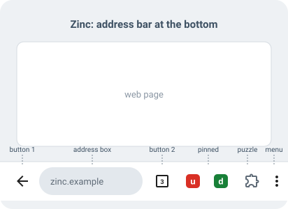

# Zinc

Zinc is an Android browser built on Chromium that runs **Chrome desktop
extensions** from the Chrome Web Store, with a phone toolbar designed around
them:

- **The address bar sits at the bottom** by default (it can still be moved to
  the top in Settings > Address bar).
- **Up to 4 fully customizable buttons** share the bar with the address box.
  You choose how many there are, which side of the address box each one is on,
  and the function each one performs.
- **Every button can be pinned to any basic browser function**: back, forward,
  reload/stop, home, new tab, new Incognito tab, tab switcher, close tab,
  recent tabs, share, bookmark this page, find in page, desktop site,
  translate, reading mode, print, add to home screen, site information, copy
  link, bookmarks, history, downloads, delete last 15 minutes, settings, the
  extensions menu, manage extensions, and the Chrome Web Store.
- **Pinned extensions sit between the right-hand buttons and the ⋮ menu.** Pin
  an extension from the puzzle menu with one tap, unpin it by long-pressing
  its icon, drag icons to reorder them. Extensions that do not fit stay in the
  puzzle menu instead of squeezing the address box.



## How Zinc is made

Like other Chromium-based browsers (Bromite, Cromite, Vanadium), Zinc is not a
copy of Chromium's 30 GB source tree. It is a small set of changes applied on
top of one pinned Chromium release:

| Path | What it is |
| --- | --- |
| `CHROMIUM_VERSION` | The Chromium release Zinc is based on (currently `157.0.8103.25`). |
| `overlay/` | New files, copied into the Chromium tree at the same paths. Most Zinc code lives here. |
| `patches/` | Changes to existing Chromium files, applied in the order of `patches/series`. |
| `args/` | GN build configurations (release arm64, release x64, developer). |
| `scripts/` | Fetch Chromium, apply Zinc, build, refresh patches, verify patches. |
| `standalone/` | Gradle build that unit-tests the toolbar model without a Chromium checkout. |
| `tools/` | Icon generator and the consistency checker used by CI. |

The patches:

1. **Branding**: the app is called Zinc and has its own launcher icon. The
   package name is `app.zinc.browser`, so it installs next to Chrome.
2. **Phone UI in a desktop-Android build**: Zinc is built with
   `is_desktop_android = true`, the configuration in which upstream Chromium
   compiles and tests its Android extensions platform (`chrome://extensions`,
   Web Store installs, extension popups, permissions). This patch keeps the
   desktop-only UI defaults (WebUI NTP and theming, side panel) off so phones
   keep the phone UI.
3. **Chrome Web Store desktop site**: the store only offers "Add to Chrome" to
   desktop browsers, so Zinc always requests its desktop site.
4. **Bottom address bar by default.**
5. **Customizable phone toolbar with pinned extensions**: the phone toolbar
   gets the Zinc buttons and hosts the extensions toolbar (upstream only shows
   it on the tablet toolbar).
6. **Settings > Toolbar**, where all of the above is configured.

See [docs/ARCHITECTURE.md](docs/ARCHITECTURE.md) for how the pieces fit
together.

## Building

You need a Linux x86-64 machine with about 150 GB of free disk, 16 GB of RAM
(32 GB recommended) and
[depot_tools](https://commondatastorage.googleapis.com/chrome-infra-docs/flat/depot_tools/docs/html/depot_tools_tutorial.html#_setting_up)
on your `PATH`. Then:

```sh
scripts/fetch_chromium.sh      # Chromium 157.0.8103.25 + Android deps, once
scripts/apply_patches.sh       # copy overlay/, apply patches/
scripts/build.sh               # -> dist/Zinc-<version>-zinc_release_arm64.apk
adb install -r dist/Zinc-*.apk
```

Full instructions, build variants, signing and how to change Zinc are in
[docs/BUILDING.md](docs/BUILDING.md).

## Using Zinc

**Customize the toolbar**: Settings > Toolbar.

- *Number of buttons*: 0 to 4.
- *Buttons left of the address bar*: how many of them sit before the address
  box; the rest sit after it.
- Tap a button row to change its function, move it to the other side of the
  address bar, move it one step left or right, or remove it. Picking a
  function that another button already has swaps the two buttons.
- *Reset toolbar* restores the default: Back on the left, tab switcher on the
  right.

Long-pressing a toolbar button shows its name; some buttons have shortcuts:
Back and Forward show the navigation history, Reload does a hard reload,
Home opens the homepage in a new tab, and the tab switcher shows its tab menu.

**Install extensions**: open the [Chrome Web Store](https://chromewebstore.google.com)
(also in ⋮ > Extensions) and tap *Add to Chrome*. Manage them at
`chrome://extensions`.

**Pin and unpin extensions**: tap the puzzle button next to the ⋮ menu and tap
the pin next to an extension. To unpin, long-press the extension's icon on the
toolbar and choose *Unpin*, or tap the pin again in the puzzle menu. Drag
pinned icons to reorder them. The puzzle button itself can be hidden in
Settings > Toolbar (it then stays reachable from ⋮ > Extensions).

## Status

What has been verified:

- The overlay and all patches apply cleanly to Chromium `157.0.8103.25`
  (`scripts/verify_patches.sh`, also run in CI), and every source file,
  string and resource the patches reference exists (`tools/check_zinc_tree.py`).
- The toolbar model (button layout rules, persistence format, width planning)
  is covered by unit tests that run without Chromium (`gradle -p standalone test`).
- All new and patched Java files parse with `javac`.

What has **not** been verified yet: a full Chromium build and on-device
testing. Building Chromium needs a dedicated machine (see above), so expect
the first build to surface compile or lint issues in the Chromium-facing
code; please report them. Known gaps:

- Zinc's own strings are English only.
- Tablets keep Chromium's tablet toolbar, which already shows extensions; the
  customizable buttons are for the phone toolbar.
- Extension support is upstream Chromium's desktop-Android implementation and
  inherits its limits. APIs that need a side panel are unavailable because Zinc
  turns the side panel off on phones.
- Some upstream unit tests assume the stock toolbar (address bar on top, stock
  home and tab switcher buttons) and need updating.

## License

Zinc's own code is under the BSD-style license in [LICENSE](LICENSE), like
Chromium. See [NOTICE.md](NOTICE.md) for third-party notices. Zinc is not
affiliated with Google.
